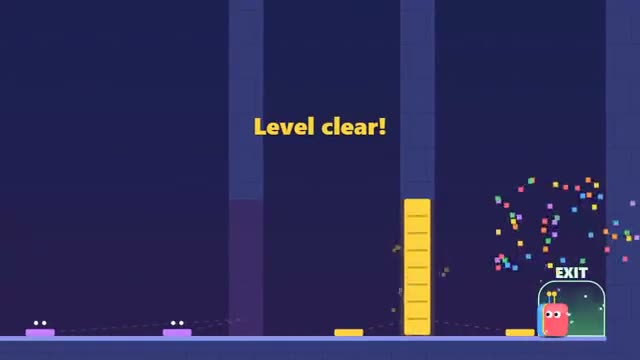

# Duo Doors

Every door needs two players. A multiplayer starter game from [Multiplayer Agent](https://multiplayeragent.com): 2D, co-op, 2–4 players, with a buddy bot when you play alone.

## How it plays

Stand on plates to hold doors open for each other, boost a friend onto high ledges, pull levers, and get everyone to the exit. Five short levels.

**Controls:** Arrow keys or WASD and Space, or on-screen buttons. Tap to send your buddy somewhere.

## Make it yours in the Game Builder

Open the [Game Builder](https://multiplayeragent.com), choose **Start from a starter game** and pick Duo Doors. It opens as version 1 in your studio, ready to play and publish. Then ask for changes, for example:

- Add a level where one player carries a key
- Add spikes that only open when a plate is held
- Turn the levels into a haunted house

## Run it yourself

1. Get a free publishable key (`pk_…`) at [multiplayeragent.com](https://multiplayeragent.com).
2. In `index.html`, put it in place of `pk_REPLACE_ME` in the `MP_CONNECT` block.
3. Open `index.html` in a browser. No build step and no server needed.

Without a key it still runs, offline with a buddy bot.

## How it is built

- One `index.html`. The comment at the top of the script maps the code and explains the multiplayer.
- The levels are text maps in `CONFIG.levels`: `#` walls, `a`–`c` plates that hold doors `A`–`C` open, purple `k` plates that need everyone at once, `x`/`y` levers, `S` start and `E` exit. Draw a new map to add a level.
- **Host-run rules:** The host's browser works out which plates are pressed and which doors are open; if it leaves, the next player takes over.
- **Bots:** Alone? A buddy bot follows you, holds plates for you and goes where you tap.
- **Leaderboard:** The fastest run through all five levels.
- **Live sync:** Everyone moves, stacks and opens doors together.
- `?attract` runs it offline with bots only. The preview video is recorded from it.

## License

MIT.
